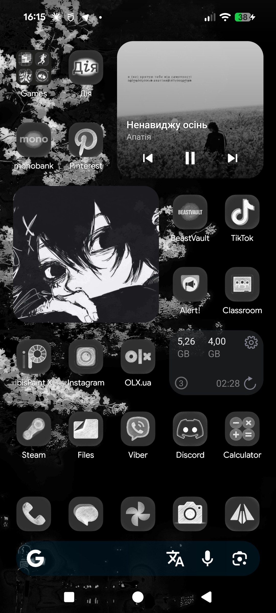
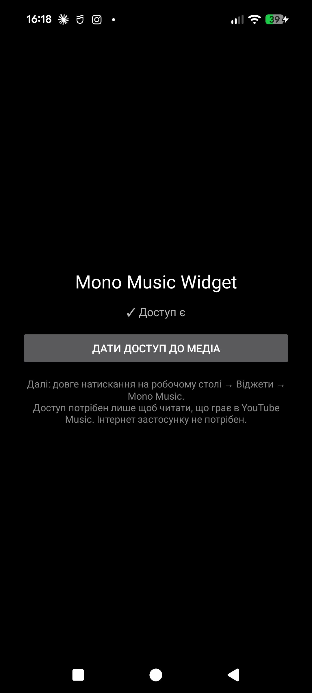

# Mono Music Widget

[Українська](README.uk.md)

A 2x2 home-screen widget for YouTube Music: album art, track title, artist and playback buttons on top. Comes in two variants - black-and-white (grayscale art) and full color - added as two separate widgets. The app needs no permissions beyond the media-session access you grant it, and only talks to the internet to check for a new release on GitHub.

<p>
  
  
</p>

## Features

- Square 2x2 widget, resizable; pick "Mono Music" (black-and-white) or "Mono Music Color" (full color) when adding it
- Album art with a bit more contrast, about 78% opaque so the wallpaper shows through
- Title, artist and previous / play-pause / next buttons over a dark gradient; the play button shows the current state
- Keeps showing the last played track instead of going blank when YouTube Music stops or closes
- Tap the cover to open YouTube Music

## How it works

A `NotificationListenerService` gets access to active media sessions, finds the YouTube Music session and listens for track and playback changes. The widget is redrawn with `RemoteViews`, and the buttons call the session's transport controls. The listener is used only to read media sessions; notifications are not read.

## Setup

1. Install the APK and open Mono Music Widget.
2. Tap "Give media access" and enable Mono Music Widget. On Android 13+ you may first need Settings > Apps > Mono Music Widget > ⋮ > "Allow restricted settings".
3. Long-press the home screen > Widgets > Mono Music.

## Tech

- Java, Android SDK only, no dependencies, no Gradle
- minSdk 26, targetSdk 34, APK size about 26 KB

## Build

Needs JDK 17+ and Android SDK (`platforms;android-34`, `build-tools;36.0.0`).

```sh
export ANDROID_HOME=/path/to/android-sdk
export SM_KS_PASS=your-keystore-password   # a keystore is created on first run if missing
sh build.sh
```

## Author

S-Mykhailo - [@savchenko_mykhailo](https://t.me/savchenko_mykhailo)

Dev channel: [t.me/s_mykhailo_dev](https://t.me/s_mykhailo_dev)

## License

GPL-3.0-or-later. You can use, change and share this code, but any modified version you distribute must also be open source under the GPL. See [LICENSE](LICENSE). Not affiliated with Google or YouTube.
