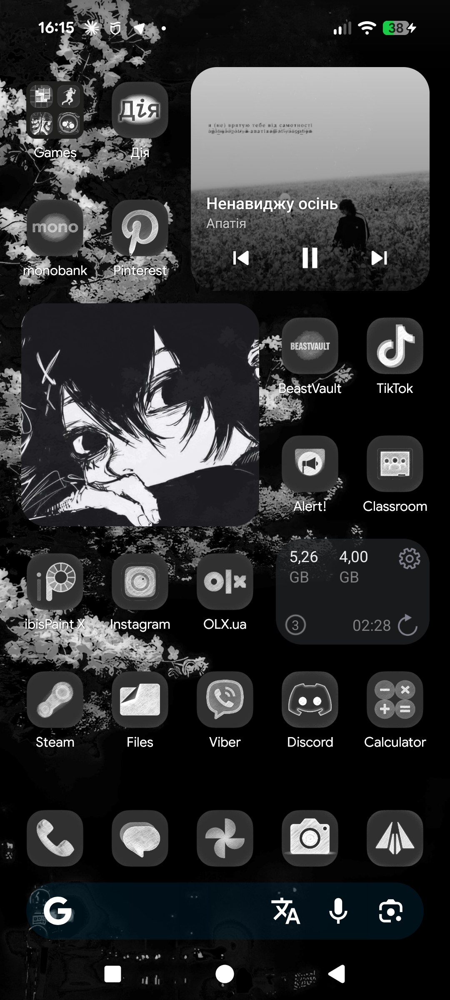
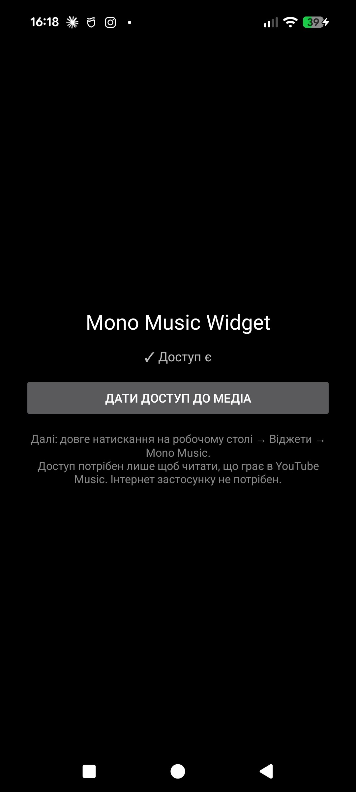

# Mono Music Widget

[English](README.md)

Віджет 2x2 для YouTube Music на робочий стіл: обкладинка, назва треку, виконавець і кнопки керування. Є два варіанти - чорно-білий і кольоровий - додаються як два окремі віджети. Застосунок не просить жодних зайвих дозволів окрім доступу до медіасесій, а до інтернету звертається лише щоб перевірити нову версію на GitHub.

<p>
  
  
</p>

## Можливості

- Квадратний віджет 2x2, розмір можна змінювати; при додаванні обери "Mono Music" (чорно-білий) або "Mono Music Color" (кольоровий)
- Обкладинка з трохи більшим контрастом, непрозора приблизно на 78%, тому крізь неї видно шпалери
- Назва, виконавець і кнопки назад / пауза / вперед поверх темного градієнта; кнопка паузи показує, грає трек чи ні
- Залишає останній відтворений трек на екрані, а не порожній віджет, коли YouTube Music зупиняється чи закривається
- Тап по обкладинці відкриває YouTube Music

## Як працює

`NotificationListenerService` дає доступ до активних медіасесій. Застосунок знаходить сесію YouTube Music і слухає зміни треку і стану відтворення. Віджет перемальовується через `RemoteViews`, а кнопки керують сесією через transport controls. Доступ використовується тільки для медіасесій, самі сповіщення не читаються.

## Встановлення

1. Встанови APK і відкрий Mono Music Widget.
2. Натисни "Дати доступ до медіа" і увімкни Mono Music Widget. На Android 13+ спершу може знадобитися Налаштування > Додатки > Mono Music Widget > ⋮ > "Дозволити обмежені налаштування".
3. Довге натискання на робочому столі > Віджети > Mono Music.

## Технічне

- Java, тільки Android SDK, без залежностей і без Gradle
- minSdk 26, targetSdk 34, APK близько 26 КБ

## Збірка

Потрібні JDK 17+ і Android SDK (`platforms;android-34`, `build-tools;36.0.0`).

```sh
export ANDROID_HOME=/шлях/до/android-sdk
export SM_KS_PASS=пароль-keystore   # якщо keystore немає, він створиться при першому запуску
sh build.sh
```

## Автор

S-Mykhailo - [@savchenko_mykhailo](https://t.me/savchenko_mykhailo)

Канал розробника: [t.me/s_mykhailo_dev](https://t.me/s_mykhailo_dev)

## Ліцензія

GPL-3.0-or-later. Код можна використовувати, змінювати і поширювати, але будь-яка змінена версія, яку ти поширюєш, теж має бути відкритою під GPL. Див. [LICENSE](LICENSE). Застосунок не пов'язаний з Google чи YouTube.
